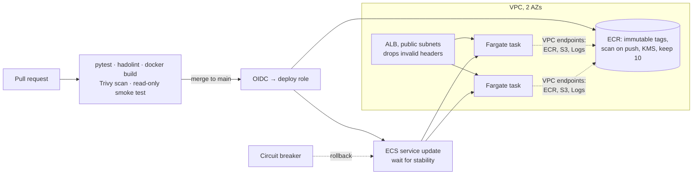

# Secure Container Delivery to ECS Fargate


A containerized service delivered by a pipeline that tests it, lints the Dockerfile, scans the image with Trivy (fails on fixable HIGH or CRITICAL issues), smoke-tests the container read-only, then pushes an immutable, commit-tagged image to ECR and rolls it out to ECS Fargate through GitHub OIDC. Tasks run in private subnets with no internet route; a deployment circuit breaker rolls back a bad release automatically.

**Problem:** teams ship images with known vulnerabilities, deploy with long-lived keys, and find out a release is broken from customers. **Outcome:** a vulnerable image cannot reach ECR, deploys need no stored credentials, and an unhealthy release reverts itself with zero downtime.

## Architecture



## Security choices

| Layer | Control |
| --- | --- |
| Image | Slim base, OS packages upgraded at build, non-root UID 10001, standard library only, HEALTHCHECK, Dependabot for base image and actions |
| Pipeline | Trivy gate, SARIF to the Security tab, hadolint, smoke test with `--read-only`, OIDC role limited to `main` |
| Registry | Immutable tags (commit SHA), scan on push, KMS encryption, lifecycle keeps 10 |
| Runtime | Read-only root filesystem, all Linux capabilities dropped, no task role permissions, private subnets, security groups ALB→task:8080 only, task egress to VPC endpoints only |
| Network | No NAT gateway: ECR, S3 and CloudWatch Logs reached through VPC endpoints |
| Release | Rolling deploy at 100/200 percent, circuit breaker with automatic rollback, 2 tasks across 2 AZs |

Checkov: Terraform 109 passed, workflows 76 passed, Dockerfile 31 passed, 0 failed.

## Deploy

Requires the GitHub OIDC provider created by [aws-secure-landing-zone](https://github.com/mk7git-hub/aws-secure-landing-zone) bootstrap, and Docker Desktop on your PC.

```bash
pytest -q                                          # 3 tests
docker build -t app . && docker run --rm --read-only -p 8080:8080 app   # http://localhost:8080/health
cd infra && cp terraform.tfvars.example terraform.tfvars
terraform init
terraform apply -target=aws_ecr_repository.app     # registry first
cd .. && ./bootstrap-image.sh                       # push the first image
cd infra && terraform apply                         # everything else
terraform output app_url
```

In GitHub: variable `AWS_DEPLOY_ROLE_ARN` = `terraform output github_deploy_role_arn`, and an environment named `production` (add yourself as a required reviewer). From then on, merging to `main` builds, scans, pushes and deploys.

## Cost

About $2 a day: ALB (~$0.55/day) plus three interface endpoints across two AZs (~$1.45/day) plus two small Fargate tasks. A NAT gateway would cost more (~$1.08/day per AZ plus data). Destroy the same day: `terraform destroy`.

## Adding HTTPS

With a domain in Route 53: request an ACM certificate, add a 443 listener with `ssl_policy = "ELBSecurityPolicy-TLS13-1-2-2021-06"`, and change the port 80 listener to a redirect. Kept out of the default so the lab works without a domain.

Design decisions and trade-offs: [docs/design-decisions.md](docs/design-decisions.md).
